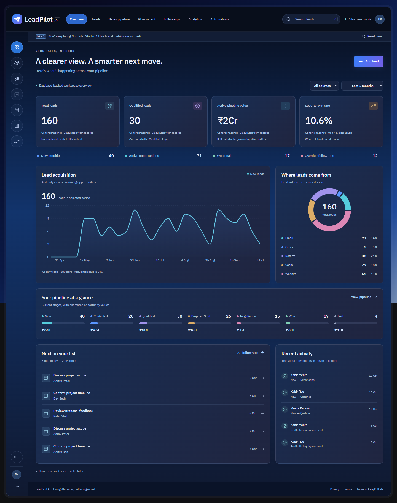
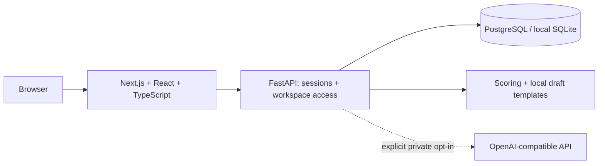

# LeadPilot AI

**Turn every inquiry into an opportunity.**

A working portfolio MVP for small service businesses: capture inquiries, manage a sales pipeline, inspect explainable qualification, prepare human-reviewed replies, and keep follow-ups visible.

[Source on GitHub](https://github.com/siddartttk/leadpilot-ai) · [Build and test results](https://github.com/siddartttk/leadpilot-ai/actions/workflows/ci.yml)

The demonstration uses **Northstar Studio**, a fictional digital services agency. Every demo receives its own 160-lead synthetic workspace. Seeded identities use `example.com`; all business figures are fictional. Local rules and message templates are clearly labeled. There is no email sending integration.



## What works

- Database-backed executive dashboard with eight calculated metrics, acquisition chart, source breakdown, pipeline values, activity, and open follow-ups.
- Lead creation, detail views, editing, archive/restore, search, source/stage filters, sorting, assignments, tags, notes, communication logs, and authorized CSV export.
- Seven-stage sales pipeline with drag-and-drop and keyboard-accessible selectors. Won deals require an actual final value; changes produce activity events.
- Transparent 0–100 qualification with five factor contributions, missing details, priority category, and suggested next action.
- Seven drafting purposes and four tones. Drafts can be edited, saved, approved, and copied. Approval never sends a message.
- Follow-up scheduling, rescheduling, completion/reopening, assignment, notes, and overdue/upcoming/completed views.
- SQL-derived cohort analytics, source conversion, value by stage, elapsed qualification/close time, and follow-up completion.
- Configurable qualification threshold and idempotent internal review task automation.
- Anonymous, resettable demo sessions; consent-aware test inquiry capture with duplicate detection, honeypot, UTM fields, and local rate limits.
- Private workspace registration/login/logout, Argon2 passwords, expiring HttpOnly sessions, CSRF checks, and backend workspace isolation.
- Responsive layouts, mobile navigation, native modal dialogs, form validation, loading/error/empty states, draft privacy/terms pages, and actual screenshots.

This is a local, tested MVP, with deployment preparation included. It is not yet a hosted service. PostgreSQL/Docker execution and live provider requests were unavailable or intentionally disabled during implementation; see [verification and limits](docs/testing.md).

## Architecture



The frontend uses Tailwind, Recharts, React Hook Form, Zod, and TanStack Query. The backend uses Python 3.12, FastAPI, Pydantic, SQLAlchemy, Alembic, and Pytest. Playwright covers complete user workflows. The midnight visual system combines navy and layered blue surfaces with cyan and violet accents, IBM Plex Sans, and Phosphor icons. The lead workspace includes database-derived summary cards, source distribution, priority review, and activity panels.

See [architecture](docs/architecture.md), [database](docs/database.md), and [API/metric definitions](docs/api.md).

[View the redesigned lead workspace](docs/screenshots/leads-desktop.png) · [Mobile lead workspace](docs/screenshots/leads-mobile.png)

## Windows local setup

Requirements: Python 3.12+, Node.js 24, and pnpm 11.25.0. No paid account or AI key is required. Run from this repository root in PowerShell.

```powershell
python -m venv .venv
python -m pip --python .venv install -r backend\requirements.txt
npm install -g pnpm@11.25.0
Copy-Item .env.example backend\.env
Copy-Item frontend\.env.example frontend\.env.local
Set-Location frontend
pnpm install --frozen-lockfile
Set-Location ..\backend
..\.venv\Scripts\python.exe -m alembic upgrade head
..\.venv\Scripts\python.exe ..\scripts\seed_demo.py
Set-Location ..
```

If Windows blocks virtual-environment pip bootstrap, `python -m venv --without-pip .venv` followed by the same `python -m pip --python .venv install ...` installs packages into the environment. Do not put secrets into tracked examples.

Start the backend in one terminal:

```powershell
powershell -ExecutionPolicy Bypass -File .\scripts\start-backend.ps1
```

Start the frontend in a second terminal:

```powershell
powershell -ExecutionPolicy Bypass -File .\scripts\start-frontend.ps1
```

Open [the local application](http://127.0.0.1:3000) and choose **Explore the demo**. Direct [demo entry](http://127.0.0.1:3000/demo) also creates an isolated session when needed. [API documentation](http://127.0.0.1:8000/api/docs) is available locally. Stop with Ctrl+C in both terminals. Reopening the project uses the same scripts; SQLite records persist in `backend/leadpilot.db`.

Optional health check:

```powershell
.\.venv\Scripts\python.exe scripts\verify_setup.py
```

## PostgreSQL and Docker

The local fallback is SQLite so the product can run without a database service. PostgreSQL is the deployment target. Start Docker Desktop, create a root `.env` with a strong `POSTGRES_PASSWORD`, then:

```powershell
docker compose up --build
```

Compose runs PostgreSQL, migration/API, and the frontend. `docker compose down` stops them while preserving the database volume. Direct PostgreSQL setup, production controls, and non-Docker options are documented in [deployment](docs/deployment.md). Docker execution has not been validated on this machine because the engine was unavailable.

## Environment variables

| Variable | Location / purpose | Default |
| --- | --- | --- |
| DATABASE_URL | Backend SQLAlchemy URL | `sqlite:///./leadpilot.db` |
| APP_ENV | Backend runtime; production enforces Secure cookies | `development` |
| ALLOWED_ORIGINS | Comma-separated browser origins | localhost/127.0.0.1 port 3000 |
| COOKIE_SECURE | HTTPS-only cookie flag | `false` locally; required `true` in production |
| AI_MODE | Backend `rules` or `live` | `rules` |
| ALLOW_LIVE_AI | Explicit server opt-in for provider calls | `false` |
| AI_API_KEY | Server-only provider secret | unset |
| AI_BASE_URL | OpenAI-compatible `/v1` base URL | OpenAI base URL |
| AI_MODEL | Configured provider model identifier | configurable example in `.env.example` |
| BACKEND_URL | Frontend API proxy destination, captured during build | `http://127.0.0.1:8000` |
| POSTGRES_PASSWORD | Root Compose environment | required for Docker |

## Scoring and AI

Qualification totals five documented factors: budget (25), service fit (25), timeline (15), completeness (15), and buying language (20). It is a configurable business heuristic, not a calibrated prediction. The UI explains every contribution and missing field. See [scoring methodology](docs/scoring.md).

Rules-based mode contacts no external model. The optional live adapter validates fact extraction and drafts with Pydantic, limits tokens, handles timeouts/failures, and omits contact email/phone from payloads. Confirm extracted facts before editing a lead and recalculating its transparent score. Public demo sessions always remain in rules mode. Live AI has not been exercised against a paid provider.

## Validation

Run backend tests:

```powershell
Set-Location backend
..\.venv\Scripts\python.exe -m pytest -q
Set-Location ..\frontend
pnpm typecheck
pnpm lint
pnpm build
```

For browser tests, keep the API running. Start the production frontend with `pnpm start` in another terminal, then run `pnpm test`. Windows tests use installed Chrome. If Chrome is unavailable, run `pnpm exec playwright install chromium` and set `$env:CI = 'true'` before testing.

The final local run passed **13 backend tests and 6 browser tests**, including migration, complete CRM workflows, and accessibility checks. The production build, strict type checks, lint, and audited application dependencies passed. The [test report](docs/testing.md) records scope and limitations. GitHub Actions runs the backend suite, production build, and PostgreSQL-backed browser tests on pushes and pull requests; [check the latest workflow result](https://github.com/siddartttk/leadpilot-ai/actions/workflows/ci.yml).

## Security and operational limits

All data endpoints check the authenticated workspace. Sessions are opaque, hashed at rest, expiring, and revoked on logout. Mutations require a CSRF token; model fields reject extra input. CSV export neutralizes formulas. Request and query sizes are bounded. No real message can be sent by the MVP. See [security controls](docs/security.md).

Before real customer deployment: implement account recovery/email verification, invitations and membership administration, ingress-level rate limits, reviewed retention/legal policies, backups/restore tests, monitoring, and deployment-specific security headers. The included rate limiter is process-local. Demo expiration stops access; an explicit operator cleanup command removes expired records. Archiving is not deletion.

The pipeline and lead selectors show at most 200 records; export caps at 10,000. The MVP uses whole INR amounts and Asia/Kolkata display time. Rules-based rewriting uses template styling rather than semantic rewriting. Proposal progression is a current-stage indicator, not a full historical milestone metric. See [known limitations](docs/limitations.md).

## Portfolio material

- [Case study](docs/freelance-case-study.md)
- [LinkedIn draft](docs/linkedin-post.md)
- [60–90 second demonstration script](docs/demo-script.md)
- [Customization services](docs/service-packages.md)
- [Implementation phase record](docs/implementation-phases.md)

[View the mobile dashboard screenshot](docs/screenshots/dashboard-mobile.png)

## Roadmap and attribution

Next priorities are PostgreSQL deployment verification, hosted demo approval, account lifecycle/admin workflows, board pagination, deeper audit/milestone analytics, and provider contract testing. Optional sending integrations require a separate consent and approval design.

Built for [siddartttk](https://github.com/siddartttk)'s freelance AI/full-stack portfolio. Licensed under [MIT](LICENSE). IBM Plex Sans, Phosphor, and dependencies retain their respective licenses. No customer testimonials or business outcome claims are fabricated.
