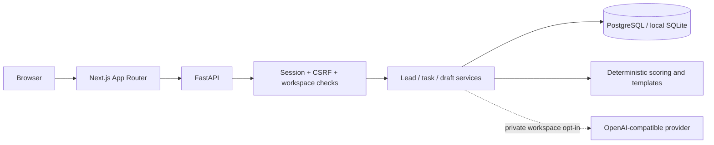

# Architecture

LeadPilot is a two-service monorepo. Next.js renders the browser application; FastAPI owns authentication, authorization, business rules, and database transactions. The UI calls same-origin `/api/*` routes, which Next.js forwards to the private API address configured at build time.

## Main boundaries

- `frontend/components`: product shell, dashboard, leads, workflow tools, public pages, accessible native dialogs and forms.
- `frontend/lib`: typed API contracts, money and timezone formatting.
- `backend/app/main.py`: HTTP routes and transaction boundaries.
- `backend/app/security.py`: password hashing, opaque sessions, CSRF, origin checks, rate limiting, resource ownership.
- `backend/app/services.py`: lead creation, status transitions, audit events, idempotent internal task automation.
- `backend/app/scoring.py`: deterministic qualification.
- `backend/app/ai.py`: local templates and a bounded, schema-validated provider adapter.
- `backend/app/analytics.py`: SQL aggregation over a consistently filtered acquisition cohort.

## Deliberate trade-offs

SQLite provides a zero-service local fallback; PostgreSQL is the deployment target. Sessions are database-backed, while rate limits are process-local. The demo is designed for one API worker behind an ingress rate limiter. No Redis, queue, autonomous agent, or outbound mail integration is required.

The UI uses TanStack Query for caching and invalidation. Lead search is debounced, list views are paginated, and charts receive aggregates. The pipeline and lead pickers display at most 200 records. Larger workspaces need server-side board paging and a search picker before rollout.

Money is stored as whole INR amounts. Timestamps are stored as naive UTC consistently; APIs normalize explicit task offsets to UTC. The UI displays Asia/Kolkata. Analytics acquisition date boundaries are explicitly UTC.
